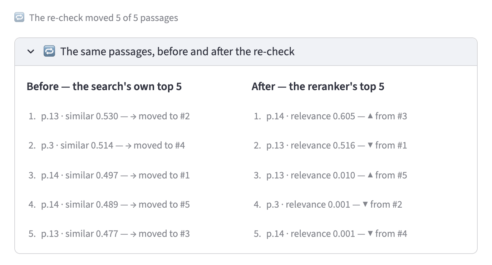

# A Basic RAG App — Ask Your Employee Handbook Questions

**RAG** (Retrieval-Augmented Generation) is the technique behind most
"AI that can read your documents." This project builds one, from scratch,
in four small steps, around a real 40-page employee handbook:

- You ask in plain English: *"Do I get paid if I'm called for jury duty?"*
- It answers **only from what it finds in the handbook** — with pages cited
- When the handbook doesn't have the answer, it **says so instead of making one up**

Every file here is deliberately small and readable: one file, one job,
no hidden machinery.

## RAG in one picture

An LLM (the AI that writes the answer) has read most of the internet — but
it has **never seen your handbook**. RAG fixes that the way an
**open-book exam** works:

1. **Retrieve** — find the few most relevant pages of the handbook
2. **Augment** — hand those pages to the LLM together with your question
3. **Generate** — the LLM answers using *only* the pages it was handed

The LLM never reads the whole 40-page handbook. It only reads the 5 most
relevant pages — so answers are grounded in your document, and cheap to produce.

```
          AHEAD OF TIME (run once)                     AT QUESTION TIME
   ┌────────────────────────────────────────┐   ┌─────────────────────────────────────────┐
   │                                        │   │ question ──► embedding                  │
   │                                        │   │         │                               │
   │                                        │   │         ▼                               │
   │                                        │   │ [3a] search: rank every chunk by        │
   │                                        │   │ similarity  ──►  20 candidates          │
   │                                        │   │                                         │
   │                                        │   │ [3b] rerank: read each candidate        │
   │ PDF ──► [1] chunks ──► [2] embeddings  │   │ together with the question              │
   │                                        │   │         ──►  top 5 chunks               │
   │                                        │   │                                         │
   └────────────────────────────────────────┘   │ [4] prompt = pages + question ──► LLM   │
   │                                        │   │                           │             │
   │                                        │   │                     final answer        │
                                                └─────────────────────────────────────────┘
```

Three ideas worth remembering:

1. **The preparation happens once.** Steps 1 and 2 run ahead of time,
   before any question is asked. (In a real system you'd re-run them
   whenever the document changes.)
2. **The LLM only ever sees 5 small pieces of the handbook** — never the
   whole document. Smaller context → cheaper, faster, and *grounded* answers.
3. **No vector database — on purpose.** Typical RAG projects store embeddings
   in a purpose-built *vector database* (Chroma, Milvus, Qdrant, …). This
   project uses a plain JSON file instead: a few hundred chunks, a few lines
   of plain Python for the search, and the whole pipeline is visible.
   Swapping in a real vector database later touches only steps 2 and 3.

## Step 1 — Cut the document into small pieces (*chunking*)

An LLM works best with small, focused text — not a 40-page document. So we
cut the handbook into pieces of about 100 words each. Every piece is tagged
with the **page it came from** — that tag is what lets us cite sources in
the final answer.

```bash
python step1_extract_and_chunk.py
```

```
Reading data/employee-handbook.pdf ...

Done! 40 pages  ->  257 chunks  ->  chunks.json

A few sample chunks (the page number lets us cite sources later):

  [p.1]  PUBLIC COUNSEL | COMMUNITY DEVELOPM ENT PROJECT | AUGUST 2017 1 SAMPLE
         EMPLOYEE HANDBOOK This document should not be con...
  [p.2]  We lcome to [ORGANIZATION]! On behalf of your colleagues...
```

Each new piece repeats a few of the last words of the previous one, so a
sentence that gets cut in half still reads sensibly. (Real PDFs extract a
little messily — split words, repeated headers. A production app would clean
the text first; we skip that here to keep the code focused on RAG.)

## Step 2 — Give each piece a "meaning fingerprint" (*embeddings*)

This is the trick that makes everything else work. A small AI model
(**MiniLM**) that runs **on your own computer** — free, private, no API key —
reads each chunk and writes down **384 numbers**. Those numbers are a
fingerprint of the chunk's *meaning*: texts about similar things get similar
fingerprints. (The model learned what "similar meaning" means by reading
enormous amounts of text while it was trained.)

We save the chunks + fingerprints + page numbers into a plain file,
`vector_store.json`. That file is our "vector database" — it stores the same
three things any real one does: the text, its embedding, its metadata.

```bash
python step2_embed.py
```

```
Reading chunks.json ...
Loading embedding model 'all-MiniLM-L12-v2' (first run downloads it, ~130 MB)...
Embedding model ready.

Embedded 257 chunks in 5.5 seconds.

Each embedding is a vector of 384 numbers.
Example — the first 8 numbers of chunk 0:
  [-0.0189  0.0452  0.0085  0.0409 -0.0312  0.0195 -0.0132 -0.0027]

Saved vector_store.json — our simple 'vector database'.
```

That's the "ahead of time" half of RAG done. Nobody has asked a question yet.

## Step 3 — Find the pages whose meaning is closest to your question

When you ask a question, we give the question the same kind of fingerprint,
then pick the 5 chunks whose fingerprints are closest. "Closest" here means
*most similar in meaning* — mathematically it's called cosine similarity, and
because these fingerprints are normalized it's just a few lines of plain
Python (multiply matching numbers, add them up; the higher, the more similar).

Now the payoff, in one command:

```bash
python step3_search.py "Can I take a day off to attend my sister's wedding?"
```

```
Question: Can I take a day off to attend my sister's wedding?

Top 5 chunks by similarity:

  0.39  [p.28]
         paid bereavement leave will be provided to regular, full- time employees.
         All other employees may request up to 3 days off without pay for bereavement...
  0.36  [p.11]  ...meal period time...
  0.35  [p.13]  ...vacation time can be used...
  0.35  [p.14]  ...[ORGANIZATION] will grant paid holidays...
  0.34  [p.29]  ...voter's receipt...
```

Notice what just happened: the word **"wedding" appears nowhere in the
handbook**. A keyword search can only match literal words, so it would find
nothing useful here. But the search matches *meaning* — the question is about
*taking time off for a family event*, and those are exactly the passages
(closest match: leave for a family death) it surfaces. That's the whole
promise of embeddings, in one command.

## Step 3.5 — Double-check the hits (*reranking*)

Similarity has a blind spot, and it's worth stating out loud: the question's
fingerprint is compared against fingerprints that were made **without ever
seeing the question**. Chunking and embedding happened ahead of time, so a
page of table-of-contents dots can look "similar" to a question about
vacation — its words are all about vacation.

The fix is the second, older trick in retrieval: a **reranker**. Instead of
comparing two fingerprints, a small *cross-encoder* model reads the question
and one chunk **at the same time** and answers one question: *does this chunk
actually answer this?* Much better judgment — and far too slow to run over
all 257 chunks, since it means reading each one from scratch. So step 3 does
what every real search system does:

1. **Search** all chunks cheaply → keep 20 candidates
2. **Rerank** those 20 carefully → keep the top 5 that go to the LLM

Ask the same question with both scores printed:

```bash
python step3_search.py "How much vacation do I get after one year?"
```

```
20 candidates found by similarity, then the reranker
re-reads them all and keeps the best 5 — both scores are shown,
so you can see what the second pass changed:

  page   similar   answers
    14      0.50     0.605
         increments of one day.xii Accumulating Vacation: Employees are encouraged ...
    13      0.53     0.516
         year Years 6 through 10 4.62 hours biweekly, for a maximum of 15 days per ...
    13      0.48     0.010
         Benefitsv iii [ORGANIZATION] has established the following vacation plan ...
     3      0.51     0.001
         Benefits.......................................................................
    14      0.49     0.001
         vacation has dropped below the cap. Vacation Pay: Vacation pay shall be ...
```

Look at page 3: **0.51 similar, 0.001 relevant** — the table of contents.
The reranker is the only stage that could tell it apart, because it's the
only stage that read it *against your question*. The chunks about actual
vacation accrual move up instead.

Two ways to see it for yourself:

```bash
python step3_search.py --no-rerank "..."   # skip the second pass
python step4_answer.py --dry-run "..."     # watch the prompt's excerpts reorder
```

In the web app you don't have to ask twice: under every answer there's a
**🔁 The same passages, before and after the re-check** panel — the search's
own top 5 in one column, the reranker's in the next, every move marked.
Here it is for the vacation question above, straight from the app:



Same five chunks in, a different reading order out. The search's #2 was that
table-of-contents line — *0.514 similar* — and the reranker, having actually
read it against the question, gave it *0.001 relevant* and sent it down to
#4; the chunk holding the real vacation accrual rules jumped from #3 to #1,
so that's the one the LLM reads first. (Flip the sidebar toggle off and the
panel disappears: with one pass there's nothing to compare.)

The cost is honest and small: one more local model (~100 MB, free to run,
downloads once), plus one pass of it over 20 candidates per question — well
under a second on a laptop. That's the standard trade: the cheap stage keeps
the expensive stage's workload tiny, and the expensive stage fixes what the
cheap one can't see.

## Step 4 — Ask the LLM to answer from those pages only

The 5 chunks the reranker picked, and your question, are wrapped into a
single prompt and sent to the LLM, with one rule: *answer only from what
you're shown — and if the answer isn't there, say so instead of guessing.*

```bash
python step4_answer.py "Can I take a day off to attend my sister's wedding?"
```

```
Question: Can I take a day off to attend my sister's wedding?

Retrieved chunks (R):
  0.000  [p.28]
  0.000  [p.11]
  0.000  [p.13]
  0.000  [p.14]
  0.000  [p.29]

Answer (from Qwen3.8-27B):

The provided handbook excerpts do not contain an answer to whether you can
take a day off to attend your sister's wedding. They only address bereavement
leave, time off to vote, meal/rest breaks, vacation eligibility, holidays,
and time off for school/child-care activities.

Sources: page 28, page 11, page 13, page 14, page 29
```

Those scores are the reranker's verdict, and they're blunt: *~0.000 for every
chunk*. Retrieval already knows none of these passages answers the question —
it's the same signal the LLM acts on below. (Compare with
`python step4_answer.py --dry-run "How much vacation do I get after one year?"`,
where the top chunks score 0.6.)

That's RAG in full: **R**etrieve the pages, **A**ugment the prompt with
them, **G**enerate an answer. And look at the behavior: the handbook has no
wedding policy, so instead of inventing "5 personal days per year," the model
*tells you what the pages actually cover*. It can't hallucinate a policy
because it was only ever shown what it found.

Ask something the handbook **does** answer, and you get the real policy with
a page citation:

```bash
python step4_answer.py "How much vacation do I get after one year?"
# → 10 days per year maximum, citing page 13 of the handbook
```

**No API key?** Add `--dry-run` to see the exact prompt the LLM would
receive, without calling it:

```bash
python step4_answer.py --dry-run "Do I get paid if I am called for jury duty?"
```

## Or just chat with it in a browser

The same four steps, as a familiar chat interface — no terminal needed
after the one-time setup:

```bash
streamlit run app.py
```

then open <http://localhost:8501>. Ask a question, get an answer, and a
footer underneath shows the handbook passages it used, with their pages and
their reranker scores — plus the before/after panel from step 3.5 (the
screenshot above is straight from this app), so the reranker's effect is
visible without asking anything twice. The sidebar
explains the whole pipeline in plain language, and its **Re-check results
with the reranker** toggle turns the second pass off entirely, so you can
see what retrieval looks like without it. Without an LLM
key the app still works: it shows the passages it found, so you can watch
the *retrieval* half of RAG — search and rerank — for free.

## What you need

- **Python 3.9+** (3.10+ recommended)
- **An API key for an LLM** — only for step 4 and the web app. Any
  OpenAI-compatible API works (OpenAI, Groq, OpenRouter, a local Ollama
  server, …).
- **Nothing else.** Both small models — the one that makes embeddings and the
  one that reranks — run on your own computer: no key, no cost, private. They
  download themselves once on first use (~130 MB and ~100 MB).

## Setup

```bash
# 1. Create a virtual environment and activate it
python3 -m venv .venv
source .venv/bin/activate        # (Windows: .venv\Scripts\activate)

# 2. Install the dependencies
pip install -r requirements.txt

# 3. Configure your LLM
cp .env.example .env
```

> Heads up: the first install is large (~1–2 GB) because
> `sentence-transformers` pulls in PyTorch. That's a one-time cost;
> afterwards the embeddings side runs locally.

Open `.env` and put your key in `LLM_API_KEY` (the defaults call
`gpt-4o-mini` at `api.openai.com`). No key? No problem — everything still
works except the final answer draft, and step 4 has the `--dry-run` mode
described above.

## Try your own questions

```bash
python step4_answer.py "Do I get paid if I am called for jury duty?"
python step4_answer.py "Can I smoke in the office?"
python step4_answer.py "Can I use my personal phone during work hours?"
python step4_answer.py "What is the policy on remote work?"
```

The last one is a good experiment: the handbook says little about remote
work, so watch the model *admit what the handbook doesn't say* — a
grounded RAG app's superpower (and, in a way, its limitation).

## Swapping models

Everything is configured through environment variables (in `.env` or in
your shell) — no code changes:

| Variable | Default | What it controls |
|----------|---------|------------------|
| `LLM_API_KEY` | — (required for step 4) | key for your LLM API (a local server may accept `none`) |
| `LLM_BASE_URL` | `https://api.openai.com/v1` | any OpenAI-compatible endpoint |
| `LLM_MODEL` | `gpt-4o-mini` | the chat model |
| `LLM_MAX_TOKENS` | `2000` | budget for the answer |
| `EMBEDDING_MODEL` | `all-MiniLM-L12-v2` | the local embedding model |
| `RERANKER_MODEL` | `cross-encoder/ms-marco-MiniLM-L-6-v2` | the local reranker (step 3.5) |
| `RERANK_CANDIDATES` | `20` | how many search hits the reranker re-reads |

Examples:

```bash
# Groq (fast, free tier)
export LLM_BASE_URL=https://api.groq.com/openai/v1
export LLM_MODEL=llama-3.1-8b-instant
export LLM_API_KEY=gsk_...

# A local Ollama server
export LLM_BASE_URL=http://localhost:11434/v1
export LLM_MODEL=qwen2.5:7b
export LLM_API_KEY=ollama   # any value works with Ollama
```

One quirk to know: **"reasoning" models** (Qwen3, the o-series, …) spend
token budget *thinking* before they answer. If an answer ever comes back
empty, the scripts tell you to raise `LLM_MAX_TOKENS`.

For embeddings, `all-MiniLM-L6-v2` is a smaller/faster alternative to the
default. If you change the embedding model, **re-run steps 2 and 3** — a
question's embedding is only comparable to chunks embedded with the *same*
model.

The reranker is a different kind of model (a *cross-encoder*), so any of them
on Hugging Face can replace it — `cross-encoder/ms-marco-MiniLM-L-12-v2` is
more accurate and slower, `cross-encoder/ms-marco-TinyBERT-L-2-v2` is quicker
and rougher. It reads your question and a chunk as one input, so it's
independent of your embedding model: swapping it needs no re-embedding. And
if you'd rather not pay for the second pass at all, `--no-rerank` skips it.

## What this version leaves out

Deliberately. Each of these is its own follow-up:

- **A real vector database** — fine for a handbook; for thousands of
  documents you'd reach for FAISS, Chroma, LanceDB, or a hosted one.
  Steps 2 and 3 are the only files you'd touch.
- **Other chunking strategies** — step 1 uses the simplest one:
  fixed-size pieces of ~100 words, split between words, a little overlap.
  (Note: this is a *cutting* choice; the embedding model from step 2 works
  on whatever pieces you give it, however they were cut.) The usual
  alternatives: cut only at sentence ends, split on section headers, or
  let the embedding model decide where the topic changes. Trying a second
  strategy — and watching what it retrieves for the same questions — is the
  most valuable next experiment.
- **Tuned reranking** — the reranker hands the LLM a fixed top 5, even when
  every score says "none of these". A cutoff (answer only from chunks above
  some relevance, or say you don't know) is the next knob — and
  `evaluate_rag.py` is how you check whether turning it helped.
- **Hybrid retrieval** — the search pass is embeddings only. Mixing in a
  keyword score (BM25) catches the exact strings embeddings blur: policy
  names, form numbers, error codes.
- **A tuned candidate list** — 20 candidates is a guess at the balance
  between the cheap pass and the careful one. `RERANK_CANDIDATES` is the
  knob; measuring what raising or lowering it costs (and gains) is the
  exercise.

One concept at a time.

## Project layout

```
├── data/employee-handbook.pdf   the 40-page source document
├── helpers.py                   .env config, embedder, reranker, LLM client
├── step1_extract_and_chunk.py   PDF → chunks + page tags  → chunks.json
├── step2_embed.py               chunks → embeddings      → vector_store.json
├── step3_search.py              question → 20 candidates → reranked top 5
├── step4_answer.py              top 5 chunks + question → LLM answer
├── app.py                       ChatGPT-style web UI (streamlit run app.py)
├── evaluate_rag.py              RAGAS scores for the same pipeline
├── screenshots/                 README images (the rerank before/after panel)
├── requirements.txt
└── .env.example                 copy to .env, add your key
```

`chunks.json` and `vector_store.json` are generated by the steps (and
gitignored); delete them at any time and re-run the steps to rebuild.

*The handbook is a sample template (by Public Counsel), so it contains
placeholders like `[ORGANIZATION]`. The RAG pipeline doesn't care — but it's
a reminder that your real data will be messier than your demo data.*
